<div align="center">

# 🔐 Cybersecurity Lab Setup — VirtualBox + Kali Linux

**Week 01 · Project Module 1 (WK1-PM1) · Building an isolated virtual lab for ethical hacking practice**

</div>

<p align="center">
  
  
  
  
  
  
  
</p>

---

## 📌 Project Overview

This repository documents the complete build of a **virtual cybersecurity and penetration-testing laboratory** created on a personal laptop using **VirtualBox** and **Kali Linux**.

The lab places every machine on a dedicated **NAT Network (`10.0.0.0/24`)** so that an attack machine and multiple future target machines can talk to each other *privately*, while still having outbound Internet access for installing tools and updating packages.

Kali Linux is configured with the fixed address **`10.0.0.2/24`**, the clipboard and drag-and-drop are enabled in both directions, and a host *Downloads* folder is shared with the VM — so files can be moved in and out without emailing them to yourself. Finally, a clean snapshot is taken so the whole lab can be rolled back to a known-good state in seconds.

> ⚖️ **Legal notice:** everything in this repository was performed on hardware and virtual machines that I own, inside an isolated lab. Nothing here was run against a network or system without written permission.

---

## 🎯 Objectives

| # | Objective | Status |
|---|-----------|:------:|
| 1 | Install 7-Zip to extract the Kali virtual-machine archive | ✅ |
| 2 | Install VirtualBox 7.x (latest stable) | ✅ |
| 3 | Create a NAT Network for `10.0.0.0/24` | ✅ |
| 4 | Download, extract and import Kali Linux into VirtualBox | ✅ |
| 5 | Enable bidirectional clipboard + drag-and-drop, and share the host *Downloads* folder | ✅ |
| 6 | Assign Kali the static address `10.0.0.2/24` with full Internet access | ✅ |
| 7 | Verify connectivity (gateway, DNS, Internet, tooling) | ✅ |
| 8 | Take a clean VM snapshot as a recovery baseline | ✅ |
| 9 | Complete the 6 Wireshark SOC labs (extra module) | ✅ |
| 9b | Document the findings of all 6 SOC captures with evidence | ✅ |
| 10 | Document every step with commands and screenshots | ✅ |

---

## 🏗️ Lab Architecture

<p align="center">
  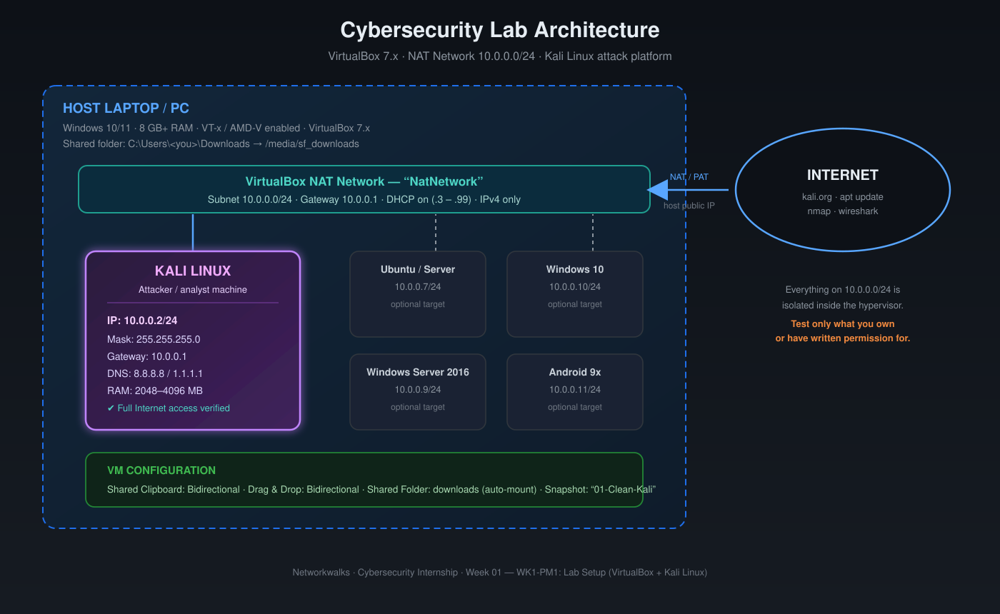
</p>

The NAT Network acts as the lab "switch". The gateway `10.0.0.1` is provided automatically by VirtualBox and performs address translation towards the Internet, which means every VM on the network can browse and `apt update`, but nothing on the Internet can reach *into* the lab.

---

## ⚙️ Lab Configuration

| 🧩 Component | ⚙️ Configuration |
| --- | --- |
| 🖥️ Host OS | Windows 10 / 11 (64-bit) |
| 🧠 Host RAM | 8 GB or more (recommended) |
| 🧰 Hypervisor | VirtualBox 7.x |
| 📦 Archive tool | 7-Zip |
| 🐉 Security OS | Kali Linux (VirtualBox image, 2025.x / 2026.x) |
| 🧠 Kali RAM / CPU | 2048–4096 MB · 2 vCPU |
| 🌐 Virtual Network | NAT Network — name `NatNetwork` |
| 📡 Network Address | `10.0.0.0/24` |
| 🚪 Gateway | `10.0.0.1` (VirtualBox default) |
| 🐧 Kali IP Address | **`10.0.0.2/24`** (static) |
| 🌍 DNS Servers | `8.8.8.8`, `1.1.1.1` |
| 📁 Shared Folder | `C:\Users\<you>\Downloads` → `/media/sf_downloads` (auto-mount) |
| 📋 Clipboard / Drag & Drop | Bidirectional / Bidirectional |
| 🔮 Future VM range | `10.0.0.3` – `10.0.0.99` |
| 🕐 Snapshot | `01-Clean-Kali-Network-Baseline` |

---

## ⚡ Quick start — all commands in one block

For anyone re-creating the lab from scratch. Full explanations, screenshots and error handling are in [docs/01](docs/01-lab-setup-step-by-step.md).

```cmd
:: ===== 1. Host: check virtualization, then install 7-Zip + VirtualBox =====
:: Task Manager > Performance > CPU > "Virtualization: Enabled"
:: https://7-zip.org/download.html            (64-bit x64)
:: https://virtualbox.org/wiki/Downloads      (Windows hosts)
"C:\Program Files\Oracle\VirtualBox\VBoxManage.exe" --version

:: ===== 2. Host: create the NAT Network 10.0.0.0/24 =====
:: GUI: File > Tools > Network Manager > NAT Networks > Create
::      Name: NatNetwork   IPv4 Prefix: 10.0.0.0/24   DHCP: on
"C:\Program Files\Oracle\VirtualBox\VBoxManage.exe" natnetwork add --netname NatNetwork --network 10.0.0.0/24 --enable --dhcp on
"C:\Program Files\Oracle\VirtualBox\VBoxManage.exe" list natnets
```

```bash
# ===== 3. Kali guest: attach adapter in VirtualBox GUI first =====
# Settings > Network > Adapter 1: NAT Network / NatNetwork
# Settings > General > Advanced: Clipboard + Drag'n'Drop = Bidirectional
# Settings > Shared Folders: host Downloads -> "downloads", auto-mount ON

# ===== 4. Kali guest: static IP 10.0.0.2/24 =====
nmcli connection show                     # confirm the profile name
sudo nmcli connection modify "Wired connection 1" \
  ipv4.method manual \
  ipv4.addresses 10.0.0.2/24 \
  ipv4.gateway 10.0.0.1 \
  ipv4.dns "8.8.8.8,1.1.1.1" \
  ipv4.dad-timeout 0
sudo nmcli connection down "Wired connection 1"
sudo nmcli connection up   "Wired connection 1"

# ===== 5. Kali guest: shared folder access =====
sudo usermod -aG vboxsf $USER             # then log out / reboot
ls -l /media/sf_downloads

# ===== 6. Kali guest: verify everything =====
ip -4 addr show eth0                      # inet 10.0.0.2/24
ip route                                  # default via 10.0.0.1
ping -c 4 10.0.0.1                        # gateway
ping -c 4 8.8.8.8                         # Internet by IP
ping -c 4 kali.org                        # DNS
sudo apt update                           # repositories reachable

# ===== 7. Snapshot the clean baseline =====
# GUI: Machine > Take Snapshot...  (Host+T)
```

```cmd
"C:\Program Files\Oracle\VirtualBox\VBoxManage.exe" snapshot "Kali-Linux-2026.1-virtualbox-amd64" take "01-Clean-Kali-Network-Baseline" --description "Static 10.0.0.2/24 on NatNetwork, GA OK, shared folder mounted, Internet verified"
```

---

# 🪜 Step-by-Step Lab Setup Procedure

> A longer, click-by-click version with every dialog, command and troubleshooting note is in **[docs/01-lab-setup-step-by-step.md](docs/01-lab-setup-step-by-step.md)**.

## Step 1 — Install 7-Zip

Kali ships its VirtualBox image as a `.7z` archive, and Windows cannot open that natively.

1. Download the **64-bit x64** installer from <https://7-zip.org/download.html>.
2. Run it and keep the default install path (`C:\Program Files\7-Zip`).
3. Verify: right-click any file → the **7-Zip** entry must appear in the context menu.

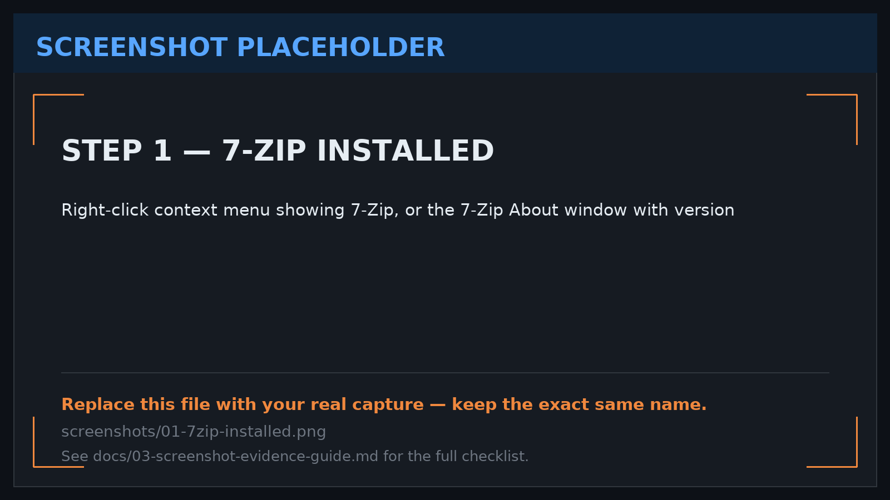

---

## Step 2 — Install VirtualBox

1. Download **VirtualBox platform package for Windows hosts** from <https://virtualbox.org/wiki/Downloads>.
2. Run the installer and accept the network-interface warning (this is normal — VirtualBox installs a virtual host adapter).
3. Allow the Oracle driver installation prompts, then reboot if asked.
4. Verify the version from a terminal:

```cmd
VBoxManage --version
```

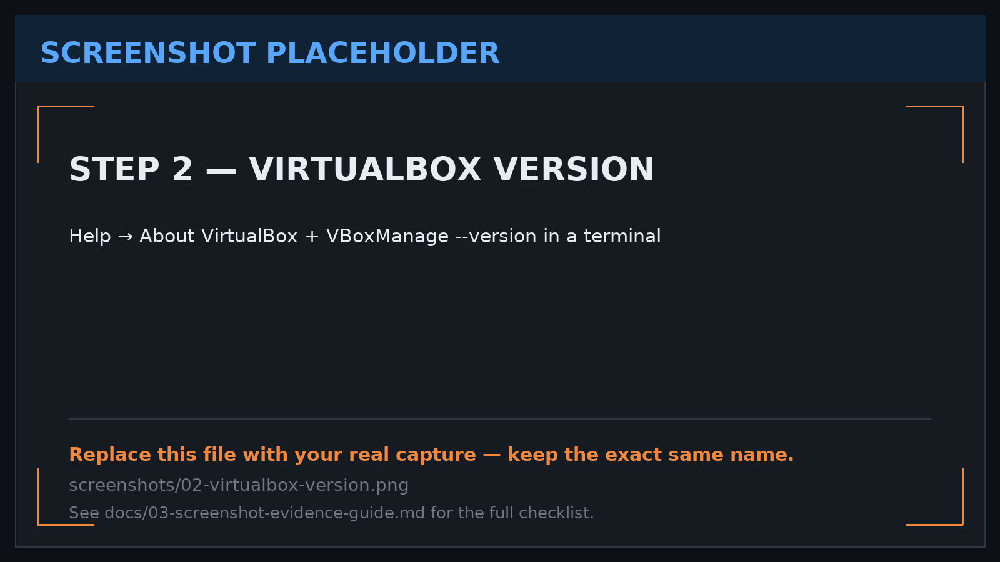

---

## Step 3 — Create the NAT Network (`10.0.0.0/24`)

A plain *NAT* adapter gives each VM its own private network, so two VMs cannot see each other. A **NAT Network** is a shared virtual switch: all VMs on it can talk to each other **and** reach the Internet.

1. VirtualBox → **File → Tools → Network Manager** → tab **NAT Networks** → **Create**.
2. Fill in:

```text
Name:            NatNetwork
IPv4 Prefix:     10.0.0.0/24
Enable DHCP:     ✔ checked
IPv6 Prefix:     (empty / disabled)
```

3. Confirm the gateway is `10.0.0.1` and, if the DHCP pool can hand out `10.0.0.2`, raise the pool's lower bound to `10.0.0.3` so it is never given to another VM (our Kali needs `.2`).
4. Click **Apply / OK**.

Verify from the host:

```cmd
VBoxManage list natnets
```

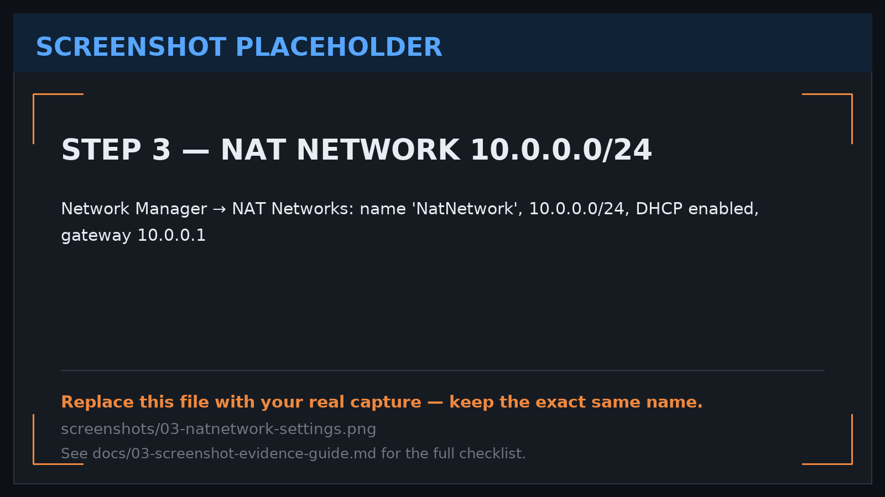

---

## Step 4 — Download and Import Kali Linux

1. Go to <https://kali.org/get-kali> → **Virtual Machines** → **VirtualBox 64-bit**.
2. Download the `.7z` archive (≈ 3 GB) **and** the `SHA256SUMS` file.
3. Check the integrity of the download (PowerShell):

```powershell
certutil -hashfile kali-linux-*-virtualbox-amd64.7z SHA256
```

4. Right-click the archive → **7-Zip → Extract Here**. You get a folder containing a `.vbox` file and a `.vdi` disk — **keep them together and do not rename them**.
5. Register the machine: double-click the `.vbox` file, or in VirtualBox use **Machine → Add** and select it.
   *(If Kali instead gives you an `.ova`, use **File → Import Appliance**.)*
6. In **Settings → System**, give the VM **2048–4096 MB RAM** and **2 CPUs**.
7. Start the VM. Default credentials of the pre-built image are `kali` / `kali` — **change the password.**

---

## Step 5 — Clipboard, Drag & Drop and the Shared Folder

**Clipboard and drag-and-drop** (VM powered off → *Settings → General → Advanced*):

```text
Shared Clipboard:  Bidirectional
Drag'n'Drop:       Bidirectional
```

Both features depend on **Guest Additions**, which are pre-installed in the official Kali VirtualBox image. Confirm inside Kali:

```bash
lsmod | grep vbox
```

If `vboxsf` / `vboxguest` are missing, install them and reboot:

```bash
sudo apt update
sudo apt install -y virtualbox-guest-x11 virtualbox-guest-utils
sudo reboot
```

**Shared folder** (*Settings → Shared Folders → ➕*):

```text
Folder Path:   C:\Users\<you>\Downloads
Folder Name:   downloads
Auto-mount:    ✔ checked
Make Permanent:✔ checked
```

Kali mounts it under `/media/sf_downloads`. The user must be a member of the `vboxsf` group:

```bash
sudo usermod -aG vboxsf $USER
# log out / reboot, then:
ls -l /media/sf_downloads
```

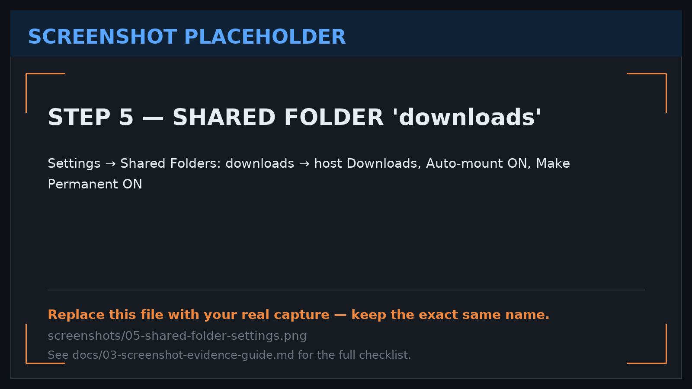

---

## Step 6 — Attach Kali to the NAT Network

VM → **Settings → Network → Adapter 1**:

```text
☑ Enable Network Adapter
Attached to:   NAT Network
Name:          NatNetwork
Advanced
  Adapter Type:      Intel PRO/1000 MT Desktop
  Promiscuous Mode:  Allow All   (useful later for sniffing between VMs)
```

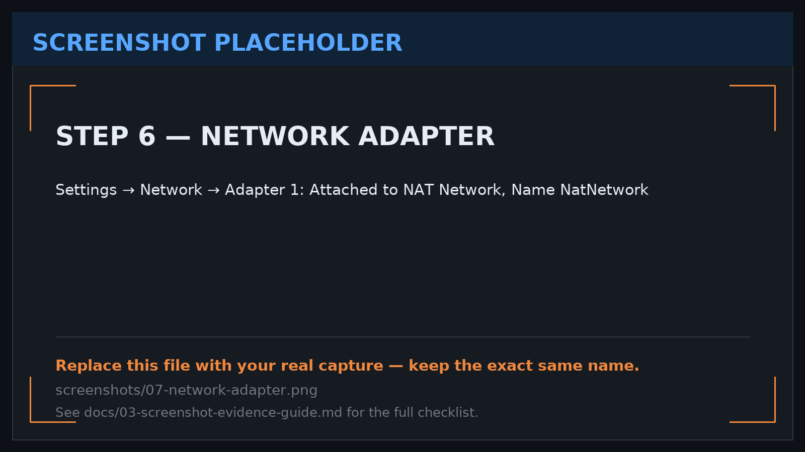

---

## Step 7 — Set the static IP `10.0.0.2/24`

First find the connection name inside Kali:

```bash
nmcli connection show
```

Usually it is `Wired connection 1`. Configure it (this is the fastest and most repeatable method):

```bash
sudo nmcli connection modify "Wired connection 1" \
  ipv4.method manual \
  ipv4.addresses 10.0.0.2/24 \
  ipv4.gateway 10.0.0.1 \
  ipv4.dns "8.8.8.8,1.1.1.1" \
  ipv4.dad-timeout 0

sudo nmcli connection down "Wired connection 1"
sudo nmcli connection up   "Wired connection 1"
```

Or do it in the GUI: **Kali menu → Settings → Network → Wired → ⚙ → IPv4 → Manual**, then fill Address `10.0.0.2`, Netmask `255.255.255.0`, Gateway `10.0.0.1`, DNS `8.8.8.8,1.1.1.1`.

Confirm:

```bash
ip -4 addr show
ip route
```

```text
2: eth0: <BROADCAST,MULTICAST,UP,LOWER_UP> mtu 1500 ...
    inet 10.0.0.2/24 brd 10.0.0.255 scope global eth0
default via 10.0.0.1 dev eth0
```

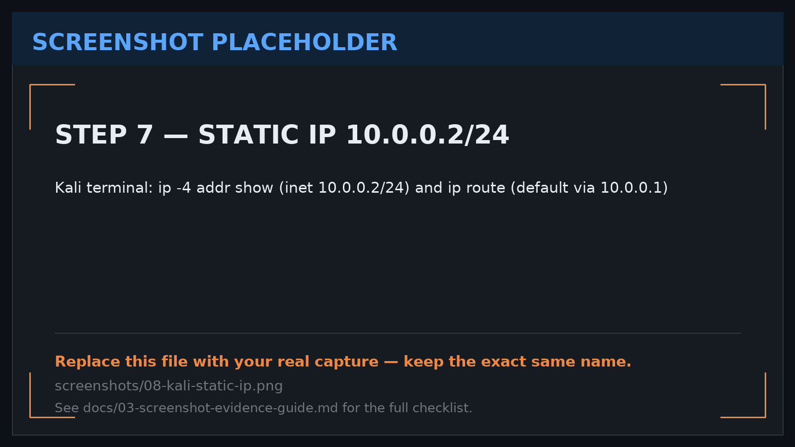

---

## Step 8 — Take a Clean Snapshot

With the VM running and the network verified, take the baseline:

**Machine → Take Snapshot…** (or `Host+T`)

```text
Name:         01-Clean-Kali-Network-Baseline
Description:  Kali with static 10.0.0.2/24 on NatNetwork, clipboard + drag&drop
              bidirectional, /media/sf_downloads shared, Internet verified.
```

Command-line equivalent:

```cmd
VBoxManage snapshot "Kali-Linux" take "01-Clean-Kali-Network-Baseline" --description "Static 10.0.0.2/24 on NatNetwork, guest additions OK, shared folder mounted"
```

If a later exercise breaks the VM, **Snapshot Manager → Restore** returns you to a working lab in under a minute.

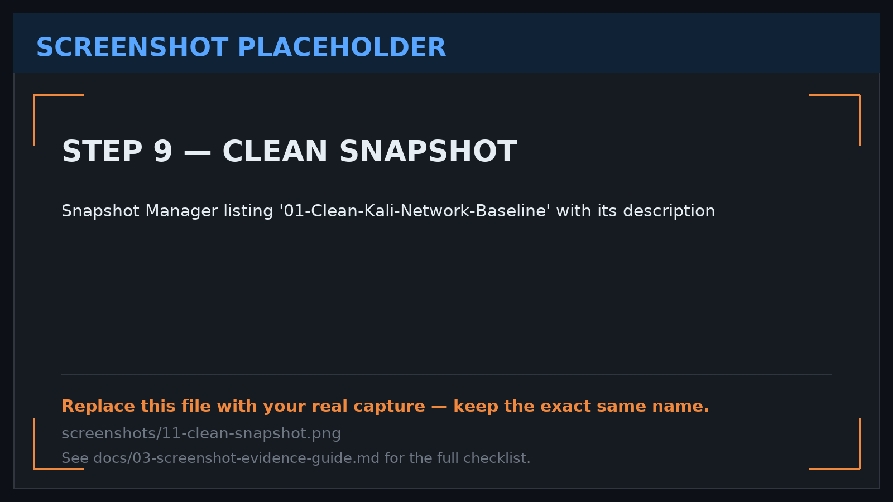

---

# 🔎 Verification

All checks were run inside the Kali VM.

| ✅ Test | 🧾 Command | 🎯 Expected result | Result |
| --- | --- | --- | :---: |
| IP address | `ip -4 addr show` | `inet 10.0.0.2/24` on `eth0` | ✅ |
| Default route | `ip route` | `default via 10.0.0.1` | ✅ |
| Gateway reachable | `ping -c 4 10.0.0.1` | 0 % packet loss | ✅ |
| Internet by IP | `ping -c 4 8.8.8.8` | 0 % packet loss | ✅ |
| Internet by name (DNS) | `ping -c 4 kali.org` | name resolves, replies received | ✅ |
| DNS server | `resolvectl status` / `cat /etc/resolv.conf` | `8.8.8.8`, `1.1.1.1` | ✅ |
| Package manager | `sudo apt update` | repositories reachable | ✅ |
| Tool check | `nmap --version` | nmap version printed | ✅ |
| Shared folder | `ls -l /media/sf_downloads` | host files visible | ✅ |
| Clipboard | copy on host → paste in Kali | text pastes both ways | ✅ |
| Snapshot exists | Snapshot Manager | `01-Clean-Kali-Network-Baseline` listed | ✅ |

```text
┌──(kali㉿kali)-[~]
└─$ ip -4 addr show eth0
2: eth0: <BROADCAST,MULTICAST,UP,LOWER_UP> mtu 1500 qdisc fq_codel state UP
    inet 10.0.0.2/24 brd 10.0.0.255 scope global eth0
       valid_lft forever preferred_lft forever

┌──(kali㉿kali)-[~]
└─$ ping -c 3 8.8.8.8
3 packets transmitted, 3 received, 0% packet loss, time 2004ms
rtt min/avg/max/mdev = 12.4/13.1/14.2/0.7 ms
```

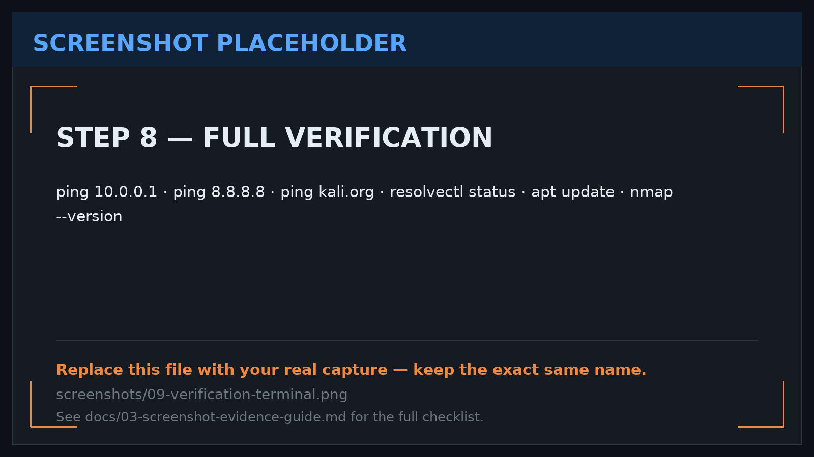

---

# 🦈 Extra Module — Wireshark SOC Labs (WK1-PMx)

Six browser-based SOC investigations were completed on top of the lab build — **10 tasks each**, using Wireshark to hunt an attacker, rebuild a conversation, pull a file off the wire, catch a password in the clear, prove a brute force succeeded and trace a scam call.

| SOC Lab | Skill practiced | What the capture revealed | Tasks | Evidence |
| --- | --- | :---: | :---: | :---: |
| Identify the Attacker's IP | endpoint / conversation analysis | automated port scan of 8 service ports (`21, 25, 139, 445, 3306, 3389, 5900, 8080`) from `192.168.10.66` → `192.168.10.20` in ~110 ms | 10/10 | [§9](docs/02-wireshark-labs-step-by-step.md#9--captured-evidence-and-findings-all-six-labs) |
| Follow TCP Stream 1 | reassembling a conversation | internal chat in plaintext leaking a temporary password, a **guest Wi-Fi PSK** and a ticket number | 10/10 | [§9](docs/02-wireshark-labs-step-by-step.md#9--captured-evidence-and-findings-all-six-labs) |
| Follow TCP Stream, Part 2 | data pulled from a server | `GET /download/report.txt` on `intranet.company.local` over HTTP, `200 OK text/plain` | 10/10 | [§9](docs/02-wireshark-labs-step-by-step.md#9--captured-evidence-and-findings-all-six-labs) |
| HTTP Plain Text Credentials | cleartext credential hunting | `POST /login` to a staff portal with `application/x-www-form-urlencoded` credentials, no TLS | 10/10 | [§9](docs/02-wireshark-labs-step-by-step.md#9--captured-evidence-and-findings-all-six-labs) |
| Catch the Brute Force Attacker | detecting repeated auth attempts | FTP password guessing against `admin` — 4 × `530` then `230 Login successful` | 10/10 | [§9](docs/02-wireshark-labs-step-by-step.md#9--captured-evidence-and-findings-all-six-labs) |
| Catch the Call Scammer | VoIP / RTP stream analysis | two-way RTP call, G.711 PCMU, `192.168.10.45:16384` ⇄ `192.168.10.52:18000`, 24 s | 10/10 | [§9](docs/02-wireshark-labs-step-by-step.md#9--captured-evidence-and-findings-all-six-labs) |

---

## Lab 1 — Identify the Attacker's IP

Filter `ip.src == 192.168.10.20 and ip.dst == 192.168.10.66 and tcp.flags.reset == 1` isolates a burst of `RST, ACK` refusals whose **source ports are a service catalogue** — the reply view of a port scan. The host that initiated it is `192.168.10.66` (source port `5231`); the scanned host is `192.168.10.20`.

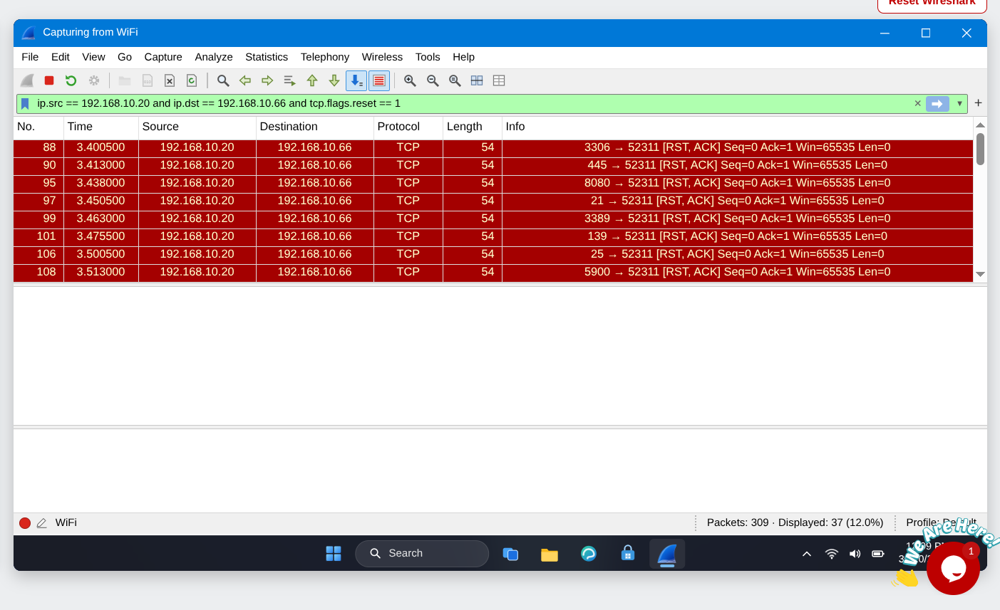

Role check on the same target host (`ip.src == 192.168.10.20`): it answers on **`80`** for `.31` (`HTTP/1.1 200 OK text/html`) and on **`443`** for `.32` (`TLSv1.2 Server Hello`) — a service provider, not a scanner. It also shows the whole point of encryption: the HTTP session is readable, the TLS one is not.

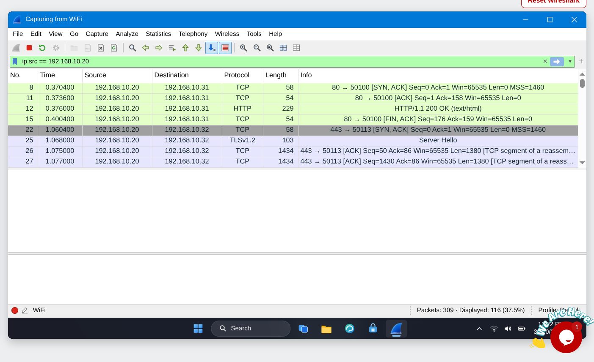

## Lab 2 — Follow TCP Stream 1

`tcp.stream eq 5` rebuilds a 9-turn "Office Chat v1.2" conversation. Credentials travelled in the clear:

```text
Sara (IT):   OK, I reset your access. Your temporary password is Tiger#4821
Ali:         Thanks. Do you also have the guest Wi-Fi password for our visitors?
Sara:        Yes. Guest Wi-Fi password: BlueHarbor77
Sara:        Bye Ali. Your ticket number is HD-20931.
```

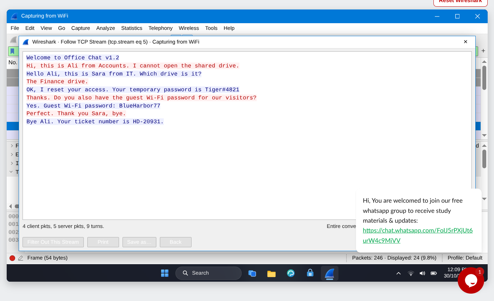

On the wire, `tcp.stream eq 5` is a **custom service on TCP `5000`** (no dissector, hence Follow → TCP Stream). Frame 87 shows `[Stream index: 5]`, and the handshake fixes the roles: `192.168.10.45:49731` is the client (Ali), `192.168.10.20:5000` is the server (Office Chat / IT).

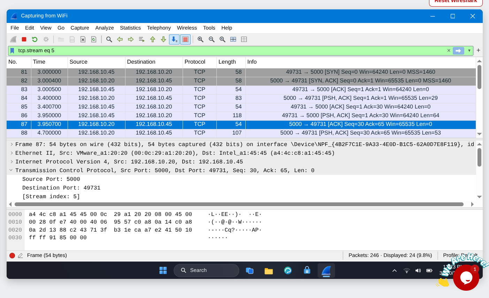

## Lab 3 — Follow TCP Stream, Part 2

`tcp.stream eq 11` shows an HTTP file pull in full: `GET /download/report.txt` for `intranet.company.local`, answered `200 OK (text/plain)` — URI, hostname and body all readable because there is no TLS.

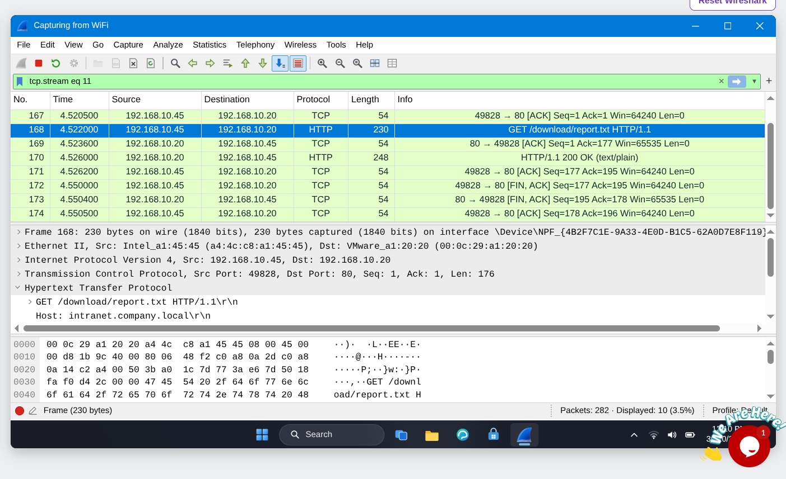

## Lab 4 — HTTP Plain Text Credentials

`tcp.stream eq 4` captures the complete login exchange: the staff-portal HTML form, then `POST /login` with `Content-Type: application/x-www-form-urlencoded` and a 36-byte body — the username/password pair, visible in the packet's **HTML Form URL Encoded** pane.

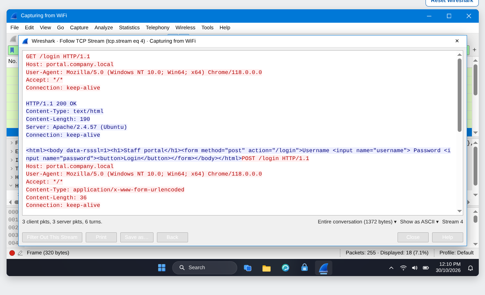

## Lab 5 — Catch the Brute Force Attacker

`tcp.stream eq 13` — an FTP session under password guessing. Four `530 Login incorrect` replies, then the fifth guess is accepted:

| Try | Username | Password | Reply |
| :---: | --- | --- | --- |
| 1 | `admin` | `Winter2025` | `530 Login incorrect` |
| 2 | `admin` | `Company1` | `530 Login incorrect` |
| 3 | `admin` | `Admin@123` | `530 Login incorrect` |
| 4 | `admin` | **`Sunshine99`** | **`230 Login successful`** |
| — | `admin` | — | `PWD` → `/` · `QUIT` → `221 Goodbye` |

The attack **succeeded** — the finding a SOC escalates as high severity.

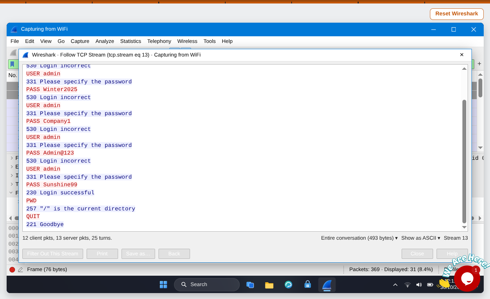

## Lab 6 — Catch the Call Scammer

`Telephony → RTP → RTP Player` decodes both legs of a 24-second call: G.711 PCMU, SSRCs `0x3A7F21C4` and `0x5B9D08E2`, between `192.168.10.45:16384` and `192.168.10.52:18000`. The waveform shows four speech bursts; **Play** streams the audio, and the SIP `From:` header supplies the caller identity.

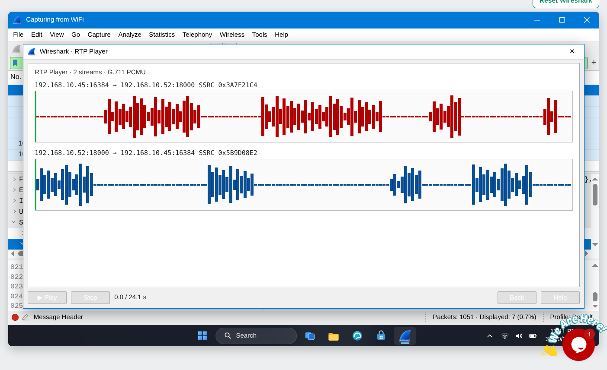

---

> 📄 Full worked method, the exact filters, the reconstructed transcripts and an impact/recommendation line for each lab: **[docs/02-wireshark-labs-step-by-step.md](docs/02-wireshark-labs-step-by-step.md#9--captured-evidence-and-findings-all-six-labs)**.
> 🖼️ Still to add: a `wireshark-lab-N-complete.png` screen per lab proving all 10 tasks were answered.

---

# 🐞 Problems Encountered & Solutions

## Problem 1 — Kali had no Internet after setting the static IP

Symptom: `ping 8.8.8.8` timed out even though `ip a` showed the correct address.

Cause: on VirtualBox 7.x with Kali 2025.1 / 2026.x, NetworkManager's **Duplicate Address Detection (DAD)** runs after the address is applied and briefly leaves the interface unusable, and the connection profile sometimes keeps an old gateway.

Solution:

```bash
sudo nmcli connection modify "Wired connection 1" ipv4.dad-timeout 0
sudo nmcli connection down "Wired connection 1"
sudo nmcli connection up   "Wired connection 1"
```

Then restart the VM. Two more causes were ruled out along the way:

1. The NAT Network not existing / named differently in *Settings → Network*.
2. The gateway entered as something other than `10.0.0.1` (VirtualBox's NAT gateway). If `10.0.0.1` is unresponsive, the network was re-created instead of patched.

## Problem 2 — VM refused to start: “VT-x is disabled in the BIOS”

Symptom: `VERR_VMX_NO_VMX` / “hardware virtualization is not enabled”.

Solution: check **Task Manager → Performance → CPU → Virtualization: Enabled**. If it says *Disabled*, reboot into BIOS/UEFI, enable **Intel VT-x** (or **AMD-V / SVM**), save and exit. On Windows hosts, **Hyper-V / WSL2 / Memory Integrity** must be disabled because they hold the virtualization extensions exclusively.

## Problem 3 — `/media/sf_downloads` did not exist

Cause: the user was not in the `vboxsf` group, and Guest Additions' shared-folder module was not loaded.

Solution:

```bash
lsmod | grep vboxsf                  # empty?
sudo apt install -y virtualbox-guest-utils virtualbox-guest-x11
sudo usermod -aG vboxsf $USER        # then log out / reboot
ls -l /media/sf_downloads
```

## Problem 4 — Clipboard / drag-and-drop greyed out in the VM menu

Cause: the setting is only applied when the VM is **powered off**, and it needs Guest Additions inside the guest. Fix: shut down the VM → *Settings → General → Advanced* → set both to **Bidirectional** → start the VM again.

> The full troubleshooting log, including what to check in which order, is in **[docs/01-lab-setup-step-by-step.md](docs/01-lab-setup-step-by-step.md#-troubleshooting-matrix)**.

---

# 💡 What I Learned

1. **NAT vs NAT Network** — plain NAT hides each VM behind its own private network, so VMs cannot see each other. A NAT Network gives every VM one shared broadcast domain *and* outbound Internet, which is exactly what an attacker/target lab needs.
2. **Static addressing matters** — a fixed `10.0.0.2` means every future note, tool profile and scan command stays valid; DHCP would silently renumber the machine.
3. **Guest Additions are the hidden dependency** behind clipboard, drag-and-drop, shared folders and a usable screen resolution.
4. **Linux networking is profile-based** — `nmcli connection modify` edits a persistent NetworkManager profile, while `ip addr add` disappears on reboot. Knowing the difference is what makes a lab repeatable.
5. **Snapshots are the cheapest insurance in cybersecurity work** — a clean baseline before every risky exercise.
6. **Documentation is part of the deliverable** — commands, screenshots, failures and fixes are what turn “I clicked around” into reproducible work.

---

# 📚 Repository Structure & Documentation

```text
Cybersecurity-Lab-Setup-1/
├── README.md                              ← this file (overview + procedure)
├── diagrams/
│   └── lab-architecture.svg               ← network architecture diagram
├── docs/
│   ├── 01-lab-setup-step-by-step.md       ← full click-by-click lab build
│   ├── 02-wireshark-labs-step-by-step.md  ← the 6 SOC labs, filters & evidence
│   ├── 03-screenshot-evidence-guide.md    ← what to capture, where, how
│   └── 04-github-linkedin-submission.md   ← submission checklist & post template
└── screenshots/                           ← evidence (see docs/03 + screenshots/README.md)
```

### 📖 Read in this order

| # | Document | What it gives you |
| --- | --- | --- |
| 1 | **[docs/01 — Lab setup, step by step](docs/01-lab-setup-step-by-step.md)** | every click, every command: 7-Zip → VirtualBox → NAT Network → Kali → clipboard/drag-drop/shared folder → static IP → verification → snapshot, plus a full troubleshooting matrix |
| 2 | **[docs/02 — Wireshark SOC labs](docs/02-wireshark-labs-step-by-step.md)** | filter cheat sheet and a method for each of the six labs, local reproduction exercises, answer sheet and report template |
| 3 | **[docs/03 — Screenshot evidence guide](docs/03-screenshot-evidence-guide.md)** | which window to open, what must be legible, file naming, capture tools, redaction and a self-check |
| 4 | **[docs/04 — GitHub & LinkedIn submission](docs/04-github-linkedin-submission.md)** | repo naming, README quality bar, post template with tagging rules, troubleshooting write-up, the four-step submission |

> ℹ️ The six `wireshark-lab-*.png` files are **real captures** from the SOC labs. The numbered lab-setup images (`00`–`12`) are **labelled placeholders** describing the exact capture each file needs — overwrite them with real screenshots using the same file names and the whole report renders with its evidence in place. See [`screenshots/README.md`](screenshots/README.md).

---

# 🔗 Tools & Resources

| Tool | Link |
| --- | --- |
| 7-Zip | <https://7-zip.org/download.html> |
| VirtualBox | <https://virtualbox.org/wiki/Downloads> |
| Kali Linux | <https://kali.org/get-kali> |
| Wireshark | <https://www.wireshark.org/download.html> |
| Networkwalks Wireshark labs | <https://networkwalks.com/wireshark/> |
| Program submission page | <https://networkwalks.com/submission/> |

---

# 🔐 Ethical Use

This lab exists for education and defensive research only. Every test described here was executed against virtual machines I own inside an isolated NAT Network. Hacking is legal only when you test **your own systems**, a **lab you built**, or a target for which you hold **written, documented permission** with an agreed scope. Misuse is a criminal offence in most countries even when nothing is damaged.

---

# 👤 Author

**Jallah** · Cybersecurity Intern — Networkwalks (`<BATCH>` batch)

- GitHub: [@Jallah-lj](https://github.com/Jallah-lj)
- LinkedIn: *add your profile link here*

---

<div align="center">

**Program:** Cybersecurity at Networkwalks · **Week:** 01 · **Project:** WK1-PM1 — Cybersecurity & Pentesting Lab Setup

</div>
